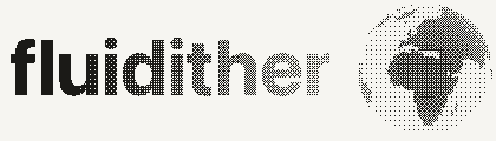
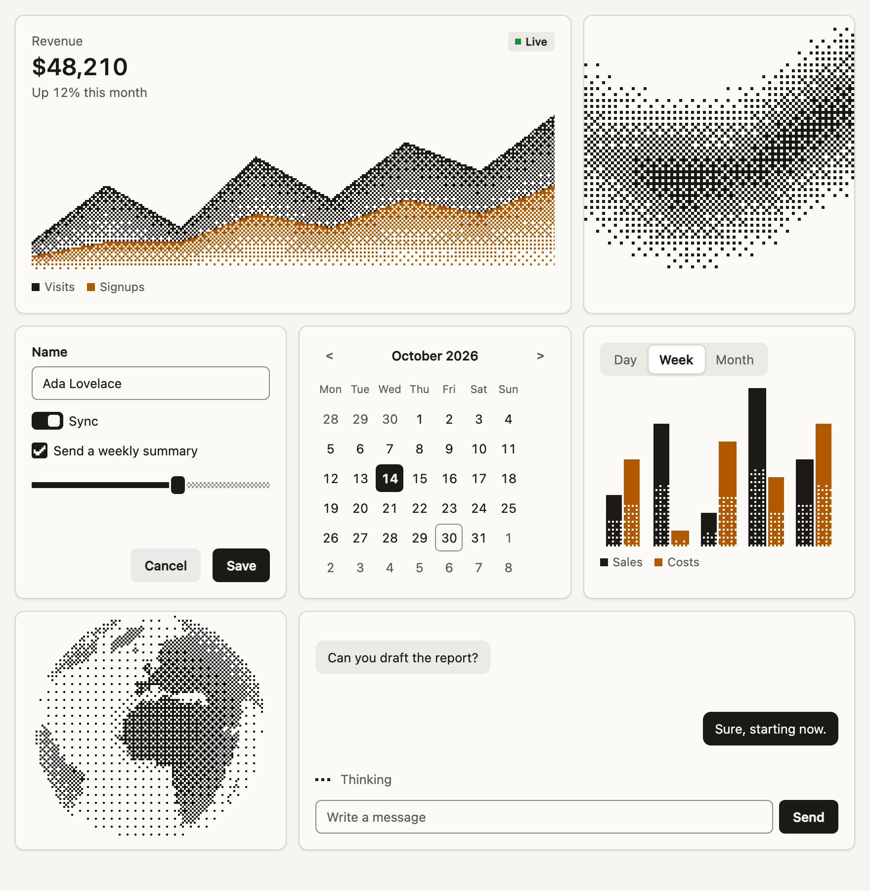
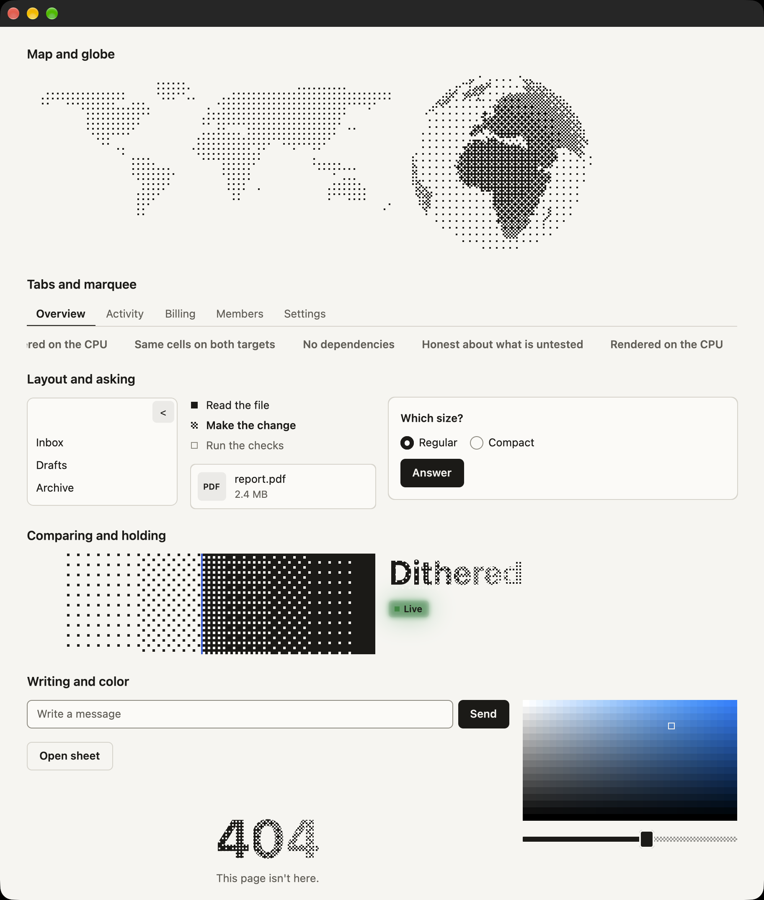

<p align="center">
  <picture>
    <source media="(prefers-color-scheme: dark)" srcset="docs/images/hero-dark.png">
    
  </picture>
</p>

<h1 align="center">Interfaces that look printed and move like they have weight.</h1>

<p align="center">
  <strong>fluidither</strong> is a dithered, spring-driven component library for the plain web and GPUI.<br>
  One set of tokens. Two targets. The same cells on both.
</p>

<p align="center">
  <a href="https://fluidither.vrnrn.com"><strong>See it live</strong></a> ·
  <a href="https://fluidither.vrnrn.com/docs">Docs</a> ·
  <a href="#get-it-in-one-command">Get started</a> ·
  <a href="#everything-you-need">Components</a>
</p>

<br>

```bash
npx fluidither
```

<p align="center">One command copies the whole library into your project. No framework, no build step, no runtime dependencies.</p>

<br>

<p align="center">
  <picture>
    <source media="(prefers-color-scheme: dark)" srcset="docs/images/showcase-dark.png">
    
  </picture>
</p>

## Your interface doesn't have to look like everyone else's

Most component libraries give you the same soft tints and the same ease curves. fluidither
starts from ink on paper. Shading is real dither, worked out cell by cell, and every movement
runs on a spring. The result looks like a print that came to life, and it still behaves like
a proper interface.

- **Dither instead of tint.** Hover states, dialog screens, chart shading and even the empty
  part of a slider are drawn in crisp cells that stay sharp at any size.
- **Motion with a job.** One dithered highlight glides between items, and neighbours merge
  into one shape, so movement always says something.
- **Springs instead of durations.** Motion keeps its speed when the target changes, things
  leave faster than they arrive, and reduced motion is respected.
- **Eighteen animated fields.** Living backgrounds, plus a globe, a world map and dithered
  images and gradients you can save as PNG.

## Built to fit into real projects

- **Plain HTML, CSS and JavaScript.** A button is a `<button>` and a dialog is a `<dialog>`, so
  the keyboard and accessibility come from the browser.
- **The code is yours.** Components are copied into your project, so you can read and change
  every line.
- **Small enough to add anywhere.** Each component loads on its own. Tokens plus an animated
  gradient come to 4.2 KB gzipped.
- **Happy under a strict CSP.** No inline styles and no `data:` images. It runs under
  `default-src 'none'`, with `script-src`, `style-src` and `img-src` set to `'self'`.
- **Two targets, one look.** The GPUI crate and the web library share their tokens, and tests
  hold their dither output to the same cells.

## Get it in one command

### On the web

```bash
npx fluidither
```

That copies everything. To take only what you need, name it, and the CLI prints the tags to
paste:

```bash
npx fluidither add tabs button gradient
```

<details>
<summary>A complete first page</summary>

Run `npx fluidither --dir my-site/fluidither`, then save this as `my-site/index.html`:

```html
<!doctype html>
<html lang="en">
  <head>
    <meta charset="utf-8" />
    <title>Hello</title>
    <link rel="stylesheet" href="fluidither/tokens.css" />
    <link rel="stylesheet" href="fluidither/components/button.css" />
    <link rel="stylesheet" href="fluidither/components/tabs.css" />
    <link rel="stylesheet" href="fluidither/components/dither-gradient.css" />
    <link rel="stylesheet" href="site.css" />
    <script type="module" src="fluidither/components/tabs.js"></script>
    <script type="module" src="fluidither/components/dither-gradient.js"></script>
  </head>
  <body>
    <fd-tabs value="week">
      <fd-tab-list aria-label="Date range">
        <fd-tab value="day">Day</fd-tab>
        <fd-tab value="week">Week</fd-tab>
      </fd-tab-list>
      <fd-tab-panel value="day" hidden>Today</fd-tab-panel>
      <fd-tab-panel value="week">This week</fd-tab-panel>
    </fd-tabs>

    <fd-dither-gradient angle="90" from="0" to="0.75" speed="0.4"></fd-dither-gradient>

    <button class="fd-button" type="button">Save</button>
  </body>
</html>
```

And this as `my-site/site.css`:

```css
body {
  background: var(--fd-paper);
  color: var(--fd-ink);
  font-family: var(--fd-font-sans);
}

fd-dither-gradient {
  height: 120px;
}
```

The modules need a web server, so serve the folder:

```bash
python3 -m http.server --directory my-site 8000
```

</details>

With a bundler, run `npm install fluidither` and import the pieces by name:

```js
import 'fluidither/tokens.css';
import 'fluidither/components/tabs.css';
import 'fluidither/components/tabs.js';
```

Themes follow the system. Set `data-theme="light"` or `"dark"` on `<html>` to force one.

### On GPUI

The same look in a native Rust app. Add the crate, with `gpui` at the same version:

```toml
[dependencies]
fluidither = "0.2"
gpui = { version = "=0.2.2", features = ["runtime_shaders"] }
```

Then in `main.rs`:

```rust
use fluidither::{Button, DitherGradient, Gradient, Look, Tabs, Theme};
use gpui::{div, prelude::*, px, App, Application, Context, Render, Window, WindowOptions};

struct Home;

impl Render for Home {
    fn render(&mut self, _: &mut Window, cx: &mut Context<Self>) -> impl IntoElement {
        let colors = Theme::get(cx).colors();
        div()
            .size_full()
            .flex()
            .flex_col()
            .items_start()
            .gap(px(12.))
            .p(px(24.))
            .bg(colors.paper)
            .text_color(colors.ink)
            .child(Tabs::new("range", ["Day", "Week", "Month"]))
            .child(DitherGradient::new("band", Gradient::default()).speed(0.4).h(px(120.)).w_full())
            .child(Button::new("save", "Save").look(Look::Soft).on_click(|_, _, _| println!("saved")))
    }
}

fn main() {
    Application::new().run(|cx: &mut App| {
        fluidither::init(cx);
        cx.open_window(WindowOptions::default(), |_, cx| cx.new(|_| Home)).unwrap();
        cx.activate(true);
    });
}
```

Building needs no Metal toolchain, because shaders compile at startup. The first build compiles
GPUI itself, which took about 10 minutes on an M1 Pro.

<p align="center">
  <picture>
    <source media="(prefers-color-scheme: dark)" srcset="docs/images/gpui-dark.png">
    
  </picture>
</p>

## Everything you need

From a button to a question flow for your AI product, all on both targets:

| Group | On both targets |
| --- | --- |
| Actions | Button, Tabs |
| Forms | Text field, Input group, Checkbox, Check group, Radio group, Switch, Slider, Swatches, Color picker, Copy field |
| Overlays | Tooltip, Menu, Select, Combobox, Dialog, Drawer, Sheet, Command menu |
| Dates | Calendar, Date picker |
| Structure | Card, Badge, Banner, Accordion, Table, Nav, Sidebar, Scroll area, Avatar, Dots, Empty state, File card, Missing page |
| Feedback | Loader, Skeleton, Progress, Divider, Stat, Sparkline, Uptime, Steps, Glow |
| Chat | Message, Thinking, Thinking steps, Composer with suggestions, Question card, Question flow |
| Charts | Bar, Area, Line, Donut, Radar, Heatmap, Gauge |
| Dither | Gradient, 18 animated fields, Halftone image, World map, Globe, Save as PNG |
| Text | Scramble, Dissolve, Count, Shimmer |
| Motion | Gliding hover, Reveal |
| Media | Compare, Marquee |

Try every one of them in the [live docs](https://fluidither.vrnrn.com/docs), which show the web
and GPUI code for each. For every attribute and method, see the
[web](skills/fluidither/references/web.md) and [GPUI](skills/fluidither/references/gpui.md)
references.

## Teach your coding agent

fluidither comes with an agent skill: the rules, a reference for each target, recipes for
common screens, and how to add to both targets. A test fails if it names anything the code
doesn't have, so your agent won't invent components.

```bash
npx fluidither skill
```

That puts it in `.agents/skills/fluidither`. For another location, such as
`~/.claude/skills/fluidither` for Claude Code, add `--dir`.

## How it works

- **Ink and paper.** Warm neutrals, with color kept for meaning. Dark mode is light ink on
  dark paper, not an inverted page.
- **Cells, not gradients.** A tone is worked out per cell, then thresholded against a Bayer
  matrix, a halftone screen or blue noise. The output is flat ink.
- **Three springs.** `quick` for hover, `glide` for movement, and `settle` for arrivals, each
  with a faster exit.
- **Pixel marks.** Ticks, dashes and arrows are small cell drawings from the tokens, so they
  match on both targets.
- **Two densities.** `regular` and `compact`, set on any element.

[Architecture](docs/architecture.md) explains how one set of tokens reaches both targets, and
how the two engines are kept in step.

## What's tested

| | Status |
| --- | --- |
| Chromium | Tested. 136 browser tests run under the strict CSP, with axe in both themes. |
| macOS on Apple Silicon | Tested with Rust 1.98.1 and `gpui` 0.2.2. |
| Firefox, Safari | Not run. Styles for them are written but have never been seen. |
| Linux, Windows | Not built for GPUI. |
| Screen readers on the web | Real elements and ARIA, but not tried with a real screen reader. |
| Screen readers on GPUI | **Not supported.** `gpui` 0.2.2 has no accessibility API, so VoiceOver can't see these components. |
| PDF previews | Not included. File cards show the type and size, because a preview needs a PDF renderer. |

There are also 36 unit tests for the web and 81 Rust tests, including parity tests that compare
the two engines cell for cell. [Support](docs/support.md) has the full list of limits and the
differences between the targets, and [Performance](docs/performance.md) has the measurements.

## Contributing

[CONTRIBUTING.md](CONTRIBUTING.md) covers the tests, tokens and how to change an engine. To run
the demos, clone the repository and use `npm run demo`, or
`cargo run --release --manifest-path gpui/Cargo.toml --example gallery` for GPUI.

## License

[MIT](LICENSE)
