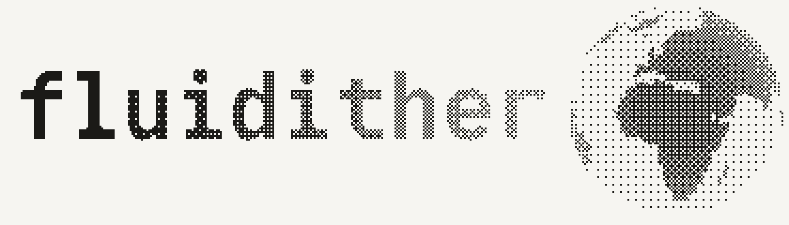
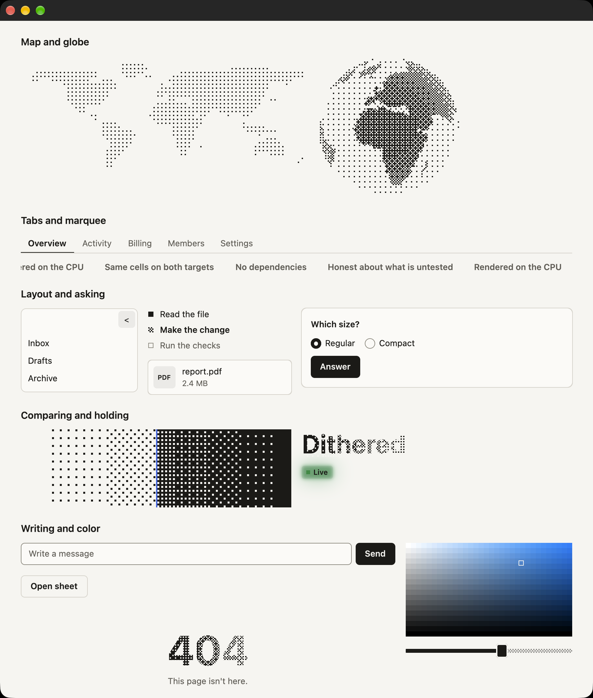

# fluidither



Dithered, spring-driven UI components for [GPUI](https://crates.io/crates/gpui). Dithers are
drawn on the CPU, and the same components exist for the plain web, with tests holding both
targets to the same cells.



## Install

```toml
[dependencies]
fluidither = "0.3"
gpui = { version = "=0.2.2", features = ["runtime_shaders"] }
```

Building needs no Metal toolchain, because shaders compile at startup. The first build compiles
GPUI itself, which took about 10 minutes on an M1 Pro.

### On gpui-pre

Apps built on `gpui-pre` 0.3.9 (including patched forks of it) turn off the
default `zed` feature and choose `pre`:

```toml
fluidither = { version = "0.3", default-features = false, features = ["pre"] }
```

`fluidither::init` installs the theme and Tab focus handling. An app that owns
its own theme and focus can call `fluidither::load_fonts` instead and use the
components, springs and dither functions directly.

## Use it

```rust
use fluidither::{Button, DitherGradient, Gradient, Look, Tabs, Theme};
use gpui::{div, prelude::*, px, App, Application, Context, Render, Window, WindowOptions};

struct Home;

impl Render for Home {
    fn render(&mut self, _: &mut Window, cx: &mut Context<Self>) -> impl IntoElement {
        let colors = Theme::get(cx).colors();
        div()
            .size_full()
            .flex()
            .flex_col()
            .items_start()
            .gap(px(12.))
            .p(px(24.))
            .bg(colors.paper)
            .text_color(colors.ink)
            .child(Tabs::new("range", ["Day", "Week", "Month"]))
            .child(DitherGradient::new("band", Gradient::default()).speed(0.4).h(px(120.)).w_full())
            .child(Button::new("save", "Save").look(Look::Soft).on_click(|_, _, _| println!("saved")))
    }
}

fn main() {
    Application::new().run(|cx: &mut App| {
        fluidither::init(cx);
        cx.open_window(WindowOptions::default(), |_, cx| cx.new(|_| Home)).unwrap();
        cx.activate(true);
    });
}
```

## Typography

`fluidither::init(cx)` registers the bundled Obel Mono roman and italic fonts.
Stats, counts, numeric table columns, copy fields and keyboard hints use it; prose and
controls inherit your app's font. Use `.font_family(fluidither::FONT_MONO)` for custom code
or short display text. Set `cx.global_mut::<Theme>().mono_font` to another loaded family
to customize the components, then refresh the window.

The original, unmasked fonts cover nine weights from 100–900. GPUI 0.2.2 selects named
faces without varying font axes, so the crate bundles the original static OTFs and picks
the nearest weight (560 selects SemiBold). These add about 3.6 MiB to the crate and require
no system font installation or network request.

## Support

Tested on macOS on Apple Silicon with Rust 1.98.1. Linux and Windows have not been built.

`gpui` 0.2.2 has no accessibility API, so VoiceOver can't see these components. Don't use this
crate alone for anything that must be accessible.

## Learn more

- [Full README](https://github.com/vrnrn/fluidither#readme)
- [Every component and method](https://github.com/vrnrn/fluidither/blob/main/skills/fluidither/references/gpui.md)
- [What has and hasn't been tested](https://github.com/vrnrn/fluidither/blob/main/docs/support.md)

## License

MIT for the library. Obel Mono by Typographic Systems is bundled under SIL OFL 1.1;
see `src/fonts/obel-mono/OFL.txt` and `AUTHORS.txt`.
